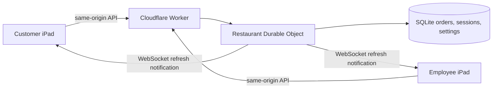

# 🍔 Caleb Bar + Bites

**Good food. Great drinks. Brighter days.**

An iPad-first restaurant ordering PWA with a warm “Barn Neon” design: forest greens, cream panels, the supplied colorful illustrated lakeside logo, a lakeside illustration, soft color accents, and large touch controls. Built with SvelteKit, TypeScript, and a Cloudflare Worker with SQLite-backed Durable Object storage.

This is a local first major working version. It does not take online payments. Read [TESTING.md](TESTING.md) for what was actually verified and the remaining physical-iPad checks. No GitHub operations or deployment were performed.

## 📱 Customer kiosk

Welcome links lead to ordering, the main menu, and the kids menu. A live device-local clock, restaurant status, connection indicator, and optional location-based weather are included. The sidebar stays visible on landscape iPads and becomes a drawer on portrait and narrow screens.

The order flow provides menu viewing, item selection, review, promotion selection, customer name, final total, and submission. Baskets survive menu visits and reloads when local storage is available. Sweet/unsweet tea and kids milk/lemonade have explicit choices. Custom requests require a description.

The kitchen must acknowledge an order before **ORDER SENT!** appears. Customers then see their order number, name, total, live status, and instructions to pay their waiter. **Start another order** resets the completed checkout.

## 👨‍🍳 Employee station

Open **Settings — Employees Only**, or hold the small lower-left emblem for two seconds. A normal tap does not open employee access. The shortcut is only navigation; every protected API verifies the server session.

The control center includes:

- **Live Orders:** item quantities, notes, options, unit and line prices, discounts, zero tax, totals, timestamps, and customer names.
- **Order History:** completed orders, stored persistently on the server.
- **Menu Manager:** toggle available/sold out; updates appear on connected customer stations.
- **Price Manager:** update fixed prices in cents; sent orders keep their original prices.
- **Restaurant Open / Closed:** controls whether the server accepts new orders.
- **Station Management:** name this local device and opt into Screen Wake Lock.
- **Display Settings:** larger item, basket, ticket, and navigation text on this device.
- **System Settings:** enable/disable promotions and inspect menu revision and payment settings.

Orders advance **NEW → ACCEPTED → MAKING → READY → COMPLETED**, one step at a time. Custom items cannot advance until an employee confirms their unit prices. A confirmed custom price immediately updates the customer’s total. Discuss that price with the guest before preparing the request.

Station management is local device configuration, not a remote fleet enrollment system. There is no inventory counting, printing, refund flow, card processor, or payment-ledger feature in this version.

## 📖 Menus & 🌈 3D flip

The main menu uses CSS perspective, two backface-hidden surfaces, and a guarded flip button at the lower right. Reduced-motion preferences switch this to a short fade. The kids menu uses the same undistorted image frame. Browser zoom is not disabled.

The original images were visible in the conversation but unavailable as local image files. **The included PNGs are clearly labeled placeholder menus**, generated from the supplied text. Replace them with the original artwork at these exact paths:

| Your image                             | Replace this file                  |
| -------------------------------------- | ---------------------------------- |
| Caleb’s Bar + Bites Main Menu.png      | `static/menus/main-menu-front.png` |
| Caleb’s Bar + Bites Main Menu Back.png | `static/menus/main-menu-back.png`  |
| Caleb’s Bar + Bites Kids Menu.png      | `static/menus/kids-menu.png`       |

Use the same filenames and genuine PNG files, preferably the original 2:3 portrait images. The app scales with `object-fit: contain`, so other proportions are not stretched. Rebuild after replacement for the production package. Existing installed clients revalidate menu images when online; offline clients retain their last cached images until they reconnect.

After inserting the originals, remove or revise the placeholder notice in `src/lib/components/MenuViewer.svelte`. Image text is separate from order data: changing a PNG does **not** change prices. Update the employee Price Manager or `src/lib/menu.ts` to keep them consistent.

Replace branding at:

- `static/icons/logo.png`: original full-resolution supplied artwork, used in the upper-left branding and lower-left shortcut.
- `static/icons/favicon-48.png`: 48 × 48 PNG browser favicon.
- `static/icons/icon-192.png`: 192 × 192 PWA icon.
- `static/icons/icon-512.png`: 512 × 512 PWA icon.
- `static/icons/apple-touch-icon.png`: 180 × 180 Apple Home Screen icon.
- `static/art/lakeside.svg`: original welcome/weather illustration.

`scripts/assets.mjs` regenerates icons **and overwrites the three placeholder menu PNGs**. Do not run it after replacing the menus unless you intend to recreate placeholders. Run `node scripts/icons.mjs` to regenerate only the branding icons from `static/icons/logo.png`, without changing any menus. The full composition is preserved without cropping. Manifest icons use `purpose: any` to avoid requesting launcher masks that could cut into the illustrated border.

## 💲 Pricing contract

All calculations use integer cents in `src/lib/pricing.ts`; the server recalculates every order with current menu data. Tax is always **$0.00**. A stale menu revision or a client-supplied incorrect total is rejected before acceptance.

The wording of the supplied offers does not specify stacking across separate subsets. This implementation makes that policy explicit: **one promotion type per order**, with repeatable complete groups. “Best single promotion” automatically picks the largest total saving. Guests may choose a different offer or no offer.

- **Sip & Share:** one main-menu bite + one main-menu mocktail saves $3.50, capped at the price of that pair.
- **BOGO:** main-menu mocktails are paired from highest to lowest price; the cheaper or equal drink in each pair is free. An odd leftover stays full price.
- **Ultimate:** two main-menu mocktails + two main-menu bites + one main-menu dessert cost $10. Higher-priced qualifying items are allocated first. A bundle already below $10 is never made more expensive.
- Kids items, drinks, custom requests, and Chef CJ’s Special are not promotion-eligible. This conservative policy is visible at review and can be changed centrally if Caleb chooses a different interpretation.

Main-menu Make Your Own Mocktail is fixed at $3.50. Custom Bite, kids Anything Else, and kids Special Mocktail Request remain `null`-priced until individually confirmed. “Known total” excludes unpriced requests; it is never labeled a final total. Chef CJ’s ingredients remain UNKNOWN.

## 📡 Realtime & persistence



SvelteKit’s static adapter builds the application into `build/index.html` and immutable assets. A Worker serves those assets and forwards `/api/*` to one Durable Object for this restaurant, identified by `RESTAURANT_ID`. This is a coordination boundary for one restaurant; a future multi-location version should route each location to its own object.

SQLite stores orders, a monotonic order counter, idempotency mappings, settings, rate-limit counters, and sessions. Order creation writes the counter, receipt, and request mapping in one synchronous transaction, then broadcasts. `BARN-001`, `BARN-002`, and later numbers stay unique within the restaurant’s retained database. Resetting its database resets this numbering.

WebSockets use Durable Object hibernation. Notifications contain only a refresh event, never customer names or order details. Clients fetch authorized data over HTTP after notifications. Exponential reconnect backoff and a 15-second refresh/heartbeat recover from missed events. A customer sees only orders belonging to its own server session; an authorized employee sees the restaurant’s orders.

A checkout UUID is persisted before sending. After an uncertain response, the basket is frozen for a same-ID retry. **Check before editing** queries the backend for that request before allowing changes. Never erase device storage to “fix” an uncertain order: ask the employee to check receipt first. Session cookies last 12 hours for customers and 8 hours after employee login. If a session expires or cookies are deleted, the employee can still find the order, but that customer browser can no longer automatically recover its details. The original checkout ID is also checked across sessions: retrying it or checking it before editing is blocked with an employee-assistance message when it was already received, preventing a second order under a new session.

There is deliberately no automatic background order submission. An offline basket waits for an explicit retry so the guest remains in control.

## 🔐 Secrets & security

`EMPLOYEE_CODE` is required for employee login. The requested real authorization value is intentionally absent from all source, examples, and client assets. Set it privately on the server. `.dev.vars.example` contains an empty placeholder; `.dev.vars` and `.env*` are ignored. `GIPHY_API_KEY` is optional and server-only.

Security includes server-owned prices, request validation and a 24 KB body limit, same-origin mutation checks, HttpOnly SameSite=Strict cookies (Secure on HTTPS), session rotation on employee login, constant-time comparison of SHA-256 code digests, employee authorization on every protected request, login throttling, per-session order throttling, and parameterized SQL. No API response containing orders or sessions is cached by the service worker.

Tests use a conspicuously synthetic credential in an isolated temporary environment file and temporary database. This fixture is not a real restaurant credential and is not bundled into the client.

This shared-code access model is intended for a small, trusted restaurant station setup. It does not provide individual employee accounts, audit identities, public-abuse protection, or a remote device registry. A public production address should use an appropriate access/rate-control policy for its intended guests. No secrets, Cloudflare accounts, or services were configured by this build.

## ☀️ Optional services

- **Open-Meteo + Browser Geolocation:** location is requested only after the guest taps Use my location. Coordinates are rounded to two decimals and sent directly to Open-Meteo, not stored on the order server. Denied location, network errors, and invalid weather data show friendly fallback text. Verify the provider’s plan/terms for the intended operation.
- **GIPHY:** the Worker proxies an optional G-rated celebration lookup. Missing keys or failed requests yield no GIF; the built-in confirmation always works. Reduced motion suppresses GIF requests.
- **Screen Wake Lock:** employee setting stored per device; requests a lock when visible and reacquires it after returning to the page. Unsupported or denied requests are harmless. It requires browser support and an appropriate secure context.
- **Clock:** uses the device’s real local time/time zone, updated once a second. No location permission is needed.

## 📲 PWA & offline behavior

The manifest sets standalone display, app identity, colors, and PNG icons. Apple touch metadata, safe-area insets, and a zoom-friendly viewport are provided.

The service worker precaches the shell, locally bundled fonts, icons, illustration, and menu images. Immutable build assets are cache-first. Menu images and navigations are network-first with cached fallback. API paths and external requests are never cached. Updates wait for existing tabs to close, avoiding mid-checkout forced reloads. Offline installation from a never-visited site is not possible; the first successful visit must populate the cache.

Browser storage may be cleared by users or the operating system. If storage is blocked, the app explains that the guest must keep the current page open; acknowledged ordering still works. A physical iPad Home Screen installation, pinch zoom, on-screen keyboard, sleep/wake, and real Wi-Fi interruptions still require device testing.

## 🗂️ Project map

| Location                                    | Purpose                                                       |
| ------------------------------------------- | ------------------------------------------------------------- |
| `src/routes/+page.svelte`                   | App shell, navigation, welcome, realtime, receipt, clock      |
| `src/lib/components/OrderFlow.svelte`       | Touch ordering and recoverable checkout                       |
| `src/lib/components/Employee.svelte`        | Auth and employee control center                              |
| `src/lib/components/MenuViewer.svelte`      | Main/kids images and 3D flip                                  |
| `src/lib/components/Weather.svelte`         | Optional weather with graceful failure                        |
| `src/lib/menu.ts`, `pricing.ts`, `types.ts` | Canonical menu, shared money logic, contracts                 |
| `worker/index.ts`                           | Worker API, authentication, SQLite Durable Object, WebSockets |
| `src/service-worker.ts`                     | PWA cache strategy                                            |
| `wrangler.jsonc`                            | Worker assets, binding, migration, compatibility date         |
| `tests/`                                    | Pricing and real-browser/API tests                            |
| `TESTING.md`                                | Test evidence, repairs, and manual checklist                  |
| `LICENSE`                                   | Custom source-available terms; not an OSI license             |

## 🧪 Local development and checks

Requires Node 22.12+ (tested with Node 24) and npm. Dependencies are locked in `package-lock.json`.

```sh
npm install
cp .dev.vars.example .dev.vars
```

Privately edit `.dev.vars` to set `EMPLOYEE_CODE`. Do not put the value in source, screenshots, shared command history, or documentation. Leave GIPHY empty unless needed.

```sh
npm run build
npm run dev
```

Open `http://localhost:5173`. This runs Vite and a local Worker API together; Vite proxies `/api` and WebSockets to port 8787. The initial build supplies Worker static assets. Local SQLite state lives in ignored `.wrangler/state`. The app still runs without an employee code, but employee login explicitly says it is unconfigured.

For production-mode local verification:

```sh
npm run build
npm run preview
```

Open `http://localhost:8787`. This serves the actual static production build and Worker API from the same local runtime. PWA behavior is best checked here rather than the development server.

```sh
npm run types
npm run check
npm run format:check
npm test
npx playwright install chromium webkit
npm run build
npm run test:e2e
```

Browser tests automatically launch an isolated Worker on port 8799, use a synthetic code, and discard their temporary database. They do not touch local restaurant data. Network-failure tests block service workers so interception is consistent; a separate Chromium test verifies the real service worker and offline reload. Playwright’s WebKit service-worker automation is unsupported; it is explicitly excluded and recorded in TESTING.md.

## ☁️ Cloudflare deployment plan

The code is prepared for one Cloudflare Worker with static assets and a SQLite Durable Object. It does not require Pages, Node hosting, a separate API server, or an external database. Wrangler generates runtime/binding types in `worker-configuration.d.ts`.

When Caleb chooses to deploy: validate the build and Worker dry run, set the real `EMPLOYEE_CODE` with Cloudflare’s secret mechanism, optionally set `GIPHY_API_KEY`, deploy the Worker and its v1 Durable Object migration, and open both stations at the same HTTPS workers.dev address or custom domain. Run the two-iPad checklist before using it for real orders. Do not deploy a public employee station with the synthetic test fixture.

No deployment or account mutation was performed. Caleb manages GitHub separately; no GitHub setup is required by the app and none was configured.

### Staff-managed items and Specials

Open **Settings**, unlock employee access, then choose **Menu Manager**. This is the full editor for names, descriptions/ingredients, categories, fixed prices, Special labels, availability, and confirmed removal. **Price Manager** remains a quick-price view of the same saved menu.

To add your two specials, use **Add menu item** for each, enter its real details and dollar price, select a category, check **Mark as a Special**, check **Enabled on customer menu**, and save. New items start disabled. No new specials are seeded automatically. Repeat this workflow for additional items without changing code.

Specials appear live alongside the illustrated menu and in the ordering menu's **Specials** filter. The original artwork is unchanged; its printed listings cannot reflect live availability or price edits. Live ordering uses current server values. A Special label does not change promotion eligibility: the existing category and kids-menu rules still apply. The Specials category itself is not eligible for category bundles. Existing employee-priced custom requests retain per-order pricing.

Use **Edit** to update details or availability, or the availability button for a quick toggle. **Remove** requires confirmation and leaves submitted orders intact. All changes use the existing Durable Object settings record and realtime refresh messages. A reviewed basket must be reviewed again after a menu change; unavailable or removed items cannot be newly ordered. No Cloudflare migration or configuration change is required.

### Thanksgiving grand opening kiosk (November 26, 2026)

The current welcome scene is Haven Hill Farm. Existing menu artwork, icons, order history, GIPHY integration and Cloudflare configuration remain intact. The welcome **Order Here** button opens live ordering; **View Menu** opens the illustrated menu. Eight suggested Thanksgiving items are disabled drafts, with descriptions that explicitly require management to confirm recipes and ingredients. They are not published products until staff enables them. Seasonal visibility defaults to **Order Here only**.

In **Settings → Seasonal Management**, use the theme toggles and preview, then edit the draft rows using the existing item editor. Review descriptions/ingredients and prices, choose **Order Here**, **View Menu**, or **Both**, then enable and save. Menu Manager continues to edit all items. Static pictures retain their printed content; live cards and checkout use server prices/availability. Thanksgiving mode controls the welcome banner, decorations have a separate toggle, and seasonal animation respects reduced-motion preferences.

Promotion controls live in the same management section. Existing three bundle formulas are retained, but the old customer promotion selector no longer grants access to them. No offer is redeemable until management explicitly creates/enables its eligibility rule and valid start/end dates. Select qualifying-cart, coupon, or manager approval requirements. Fixed credits, percentages and free-item offers require a qualifying item; all offers have a global redemption cap and can apply only once per customer session. Configure a cap of **1** for a truly single-use coupon. Anonymous sessions are not verified individual people: resetting cookies creates another identity, so a per-person/membership limit requires a real identity system. No membership implementation existed in this project; member-only rules deliberately remain unavailable.

Coupon values are stored as server-side hashes; public settings expose only whether a code is configured. Coupon quote attempts are throttled. One offer can apply per order. The server recalculates cart requirements, dates and approval on every quote and submission; it rejects supplied discount/credit/membership claims, and consumes redemptions atomically with order creation. Lost-acknowledgement retries return the original order without another redemption. Redemptions can be reviewed by staff. Manager approval requires the customer's request ID shown during checkout and produces a customer-bound, one-use token lasting 10 minutes. There is no automatic staff approval.

Checkout displays subtotal, verified discounts, masked applied-coupon reference and amount due. Submission creates an **unconfirmed** payment state; it does not collect or confirm payment. Customers deposit exact payment at the Payment Station and ring the bell only for change or assistance. This does not introduce a payment ledger or card processor.

The service worker continues to exclude API/external requests and waits to activate. A ready-update notice asks users to finish checkout and close all app windows before reopening. After an approved deployment, open online, finish active orders, close every Caleb's PWA/Safari window, and reopen. If still on the old version, open online again to allow the new worker to install, then close and reopen once more. Never clear site data while an order acknowledgement is uncertain. Physical iPad installation/offline lifecycle still needs device testing.

### Announcements and temporary weather pause

Weather is intentionally hidden behind `weatherEnabled = false` in `src/lib/announcements.ts`. No Weather component is mounted on customer screens, including an old `#weather` bookmark. `Weather.svelte`, `worker/weather.ts`, `/api/weather` and the private OpenWeather configuration remain intact for a future explicitly requested restoration. This update does not repair or reactivate weather.

The welcome panel now displays Restaurant Announcements with an **Explore Specials** button that opens the Thanksgiving ordering filter. Default messages include opening day, specials, mocktails, infused water, charging, member-card acceptance, thanks and the farm welcome. Member-card acceptance is informational signage supplied by the owner; this does not add a membership verification or payment-processing system.

Use **Settings → Announcement Manager** to create/edit drafts, enable or disable messages, move them up/down, set optional icons/images and dates, and choose rotating, single, or seasonal-decoration display. **Save announcement draft** stages an edit; **Preview announcements** previews the staged list; **Publish announcements** makes the whole list live across stations. Delete requires confirmation and publishing. A stale publication is rejected so another staff device's changes are preserved; reload published announcements before retrying. Saved lists persist in the existing Durable Object settings record, including an empty list. Announcement defaults are initialized once for legacy settings rather than overwriting saved messages on updates.

Rotation advances every eight seconds, with Next and Pause/Resume controls. It pauses for reduced-motion preferences and hidden pages. Optional images must use HTTPS or a local `/art/` asset; images are lazy-loaded, displayed as decoration, and hidden on load failure. Use optimized images under 200 KB where possible. External images are not fetched by the Worker or cached by the service worker.

**Settings → Seasonal Management** independently controls turkey decorations, pumpkins, leaves, falling leaves, confetti, seasonal announcements, farm scenery and other decoration, alongside the existing Thanksgiving and master decoration/animation controls. **Lightweight graphics mode** chooses small SVG farm/turkey assets, omits optional announcement images and generic menu illustrations (the approved small product photos remain) and extra food decorations, reduces shadows and stops falling leaves. Reduced-motion always wins over animation settings. Decorative layers cannot capture touch input.

New cohesive illustrations are stored in `static/art/farm-illustrated.webp`, `turkey.webp`, and `seasonal-table.webp`, totaling approximately 206 KB. They were generated for this project, cropped into separate assets and WebP-optimized. Existing menu artwork and icons remain untouched. Food illustrations are illustrative, not promises of ingredients for unreviewed draft products. Bundled art is included in the existing offline asset cache.

### GIPHY configuration diagnostics

**Settings → System Settings → Check GIPHY configuration on this server** asks a staff-only endpoint about the Worker serving the current origin. Empty, whitespace-only, quoted-empty and recognized placeholder values report **Not Configured** and never trigger a GIPHY request. A nonempty value reports **Configured (not verified)**; presence is not provider authorization. No key or key fragment is returned. GIPHY remains optional and provider failures still produce no GIF without blocking order confirmation.

Local `npm run dev` uses Wrangler's `.dev.vars` (or its selected environment/explicit env file); the deployed app uses Cloudflare Worker bindings/secrets. A Cloudflare `secret list` entry proves only that a secret **name** exists, not that its value is useful. Production does not read your desktop `.dev.vars` at runtime. Changing a local file does not change a deployed secret. Restart local development after editing local configuration before comparing statuses. This diagnostic does not read or verify another origin's environment, modify secrets, or make a provider request.

### Approved Thanksgiving specials and deals

The approved live seasonal catalog now contains Gobble Bites (six nuggets, $4), Grilled Cheese Bites (half a grilled cheese cut into bite-sized pieces, $2), Thankful Snack Cup (small popcorn/cheddar-square mix, $1.75), Harvest Crunch Cup (apple slices with cheddar squares, $2), Golden Gobbler (pineapple/orange/ginger beer, $3.75), and Autumn Mini Sparkler (smaller lavender/ginger-beer mocktail, $3.50). These nine approved products, including the deals below, start enabled and Order Here-only. Ordinary menu prices are unchanged.

- Gobble & Sip: Gobble Bites + Golden Gobbler, $7.
- Little Thanksgiving Combo: Grilled Cheese Bites + Autumn Mini Sparkler, $5.
- ULTIMATE THANKSGIVING DEAL: Gobble Bites + Grilled Cheese Bites + Golden Gobbler + small popcorn, $10.

Deals are fixed-content purchasable products, not customer-granted discounts. The shared server quote validates every component, disallows an unavailable/removed/menu-only component, records the component names and counts in the order snapshot, and charges the lower of the configured deal price or separate component total. The small popcorn in ULTIMATE uses the regular popcorn catalog entry as its availability dependency and price comparison, with its serving explicitly recorded as Small popcorn. An additional promotion cannot stack onto an order containing a deal. Existing employee editing/availability/removal controls apply. Legacy unreviewed Thanksgiving draft IDs remain retired for data compatibility and cannot be re-enabled; past orders are untouched. No cider, ginger ale, cranberry or lime recipes were added.

Each approved item uses a distinct real stock-food reference photo or a panel combining real component photographs. Photos are optimized WebP, kept separate from item text, letterboxed rather than cutting content to fit, and credited at `/special-photo-credits.html`. These photos are not actual Caleb's servings. One outstanding visual limitation is the Grilled Cheese Bites photo: it is a real grilled-cheese-halves reference, not an actual chopped-bites photo. Replace it with an owner-supplied serving photo when available; no synthetic chopped-food image was generated. The item name, portion and description already specify bite-sized pieces.

### Active Thanksgiving 2026 menu artwork

The viewer now uses `static/menus/main-menu-front-thanksgiving-2026.png`, `main-menu-back-thanksgiving-2026.png`, and `kids-menu-thanksgiving-2026.png`. The original three PNGs remain unchanged as backups. All six files retain their supplied 1024×1536 resolution. Static menu images are picked up automatically by the existing service-worker asset cache; no cache policy change is required. Artwork selection is independent of decoration mode.

Catalog synchronization is now owner-approved: Turkey Slider ($4.75), Mashed Potato Cup ($3.75), Butter Corn Cup ($3), Harvest Sparkle ($4.75), Pumpkin Pie Mocktail ($4.50), and Fruit Sorbet ($2) are orderable. The five Thanksgiving dishes/drinks have separate main/kids entries. Printed legacy promotions still depend on management-controlled server eligibility rules. Cherry Pop has no lime juice; a visible home/menu correction explains the outdated printed ingredient list.


### Approved artwork-to-catalog additions

All three Thanksgiving PNGs were compared with the catalog. The front/back ordinary foods, drinks, mocktails, Chef CJ’s Special/Featured Special, existing seasonal items and three Thanksgiving deals retain their prices and ordering paths. The kids page's five extra seasonal items are now enabled in both main and kids ordering, with separate editable IDs:

| Item | Category | USD price | Description |
| --- | --- | --- | --- |
| Turkey Slider | Bites | $4.75 | Turkey, cheese, and a soft bun. |
| Mashed Potato Cup | Bites | $3.75 | Creamy and smooth! |
| Butter Corn Cup | Bites | $3.00 | Warm and tasty! |
| Harvest Sparkle | Mocktails | $4.75 | Ginger beer, orange syrup and a touch of honey syrup. Alcohol-free. |
| Pumpkin Pie Mocktail | Mocktails | $4.50 | Creamy vanilla and honey syrup with a spiced pumpkin flavor. Alcohol-free. |
| Fruit Sorbet | Desserts, main menu | $2.00 | Served in a real fruit shell. |

Fruit Sorbet uses a new ID; the old Kirkland bar ID is disabled and hidden from staff/customer menus rather than being reassigned, preserving old order snapshots and rejecting stale bar baskets. All other products and original menu PNGs are retained. Both Cherry Pop entries now say lemon-lime soda, cherry syrup and cherry juice, with an explicit no-lime-juice clarification. Original artwork is not edited or blacked out; the home and menu pages show the correction.

The new main Bites/Mocktails and Fruit Sorbet can qualify for the existing configured promotion recipes. Kids entries remain excluded from main-menu bundles. The original recipes and manager-controlled eligibility/expiry/redemption checks are unchanged; no checkout discount was enabled automatically. Staff can edit names/descriptions/categories/prices/availability in Menu Manager, and the kids seasonal filter is now visible. All prices are integer cents and all order quotes are computed on the Worker. New stock photos are optimized, representative food-type references, not promises of exact portions, garnish or recipes; the catalog text controls actual ingredients. Attribution remains at `/special-photo-credits.html`. No additional recipes, prices or ingredient substitutions were inferred from stock imagery.

No additional numeric price conflicts were found across the three supplied PNGs. Chef’s Featured Special is the existing Chef CJ’s Special, not a duplicate unpriced product. Printed offers still require their configured eligibility; they are not unconditional checkout discounts. Sorbet flavor and the exact vanilla/pumpkin preparation are not specified beyond the owner's supplied wording and should be confirmed by staff rather than invented.
